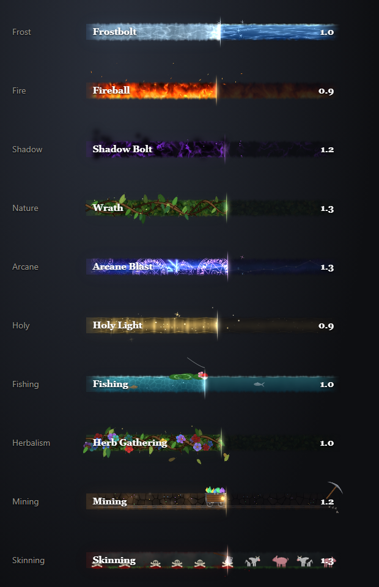

# Dave's WoW Addons

World of Warcraft addons for **WoW: Forever** (Interface `16001`), plus the toolkit (`wow-addon-kit`) used to scaffold, validate, review, debug, and link them.

## Contents

| Folder | What it is |
| --- | --- |
| [`wowaddons/daves_balls`](wowaddons/daves_balls) | **Dave's Balls**: Diablo-style health and power orbs with sloshing liquid and cursor glare (`v0.1.5`) |
| [`wowaddons/daves_castbar`](wowaddons/daves_castbar) | **Dave's Cast Bar**: animated player cast bar with 20 procedural looks — 7 elements, 4 gathering & 6 crafting professions, Disenchant, First Aid, and Plain (`v0.5.4`) |
| [`wowaddons/daves_chat`](wowaddons/daves_chat) | **Dave's Chat**: movable wide-screen chat dock (`Chat`, `Combat Log`, `General`) with an auto-closing collapsible left tab list, bordered inner chat pane, `Text direction`, and frosted-glass `Faint` mode (`v0.3.11`) |
| [`wowaddons/daves_frames`](wowaddons/daves_frames) | **Dave's Frames**: custom target unit frame with central portrait ring, inward-emptying health & resource bars, hanging aura boards on chains, and 9 player class plates (`v0.2.10`) |
| [`wowaddons/daves_map`](wowaddons/daves_map) | **Dave's Map**: Map Genie pin layer, quest chain links, search/filter sidebar, Ready-to-Turn-In & zone quest tracker, quest focus, and OpenMap seamless world map (`v0.5.7`) |
| [`wowaddons/daves_outofmyway`](wowaddons/daves_outofmyway) | **Dave's Out Of My Way**: Edit Mode Need/Greed loot-roll mover and never-collapsed buff frame (`v0.1.5`) |
| [`wowaddons/daves_sack`](wowaddons/daves_sack) | **Dave's Sack**: all-in-one HUD Edit Mode bag replacement with collapsible categories or an optional "One big bag" slot grid, reagent-bag routing, trash/delete button, local Auction House price cache & tooltips, and taint-safe secure controls (`v1.7.25`) |
| [`wow-addon-kit`](wow-addon-kit) | Plugin (`wow-forever-addons`) and Python CLI toolkit for scaffolding, static API/secret/taint validation, review packets, in-game error/taint inspection, and linking |

## The addons

### Dave's Cast Bar (`daves_castbar`)

An animated cast bar that replaces Blizzard's. Each spell gets one of 20 looks, and every cast is different: seven elements (`frost`, `fire`, `shadow`, `nature`, `lightning`, `arcane`, `holy`), four gathering professions (`fishing`, `herbalism`, `mining`, `skinning`), six crafting professions (`smelting`, `blacksmithing`, `alchemy`, `tailoring`, `leatherworking`, `enchanting`), `disenchant`, `firstaid`, and Blizzard's `plain` bar — picked automatically from the spell or its recipe. Framed or borderless, square, soft or rounded corners, flat or bevelled.



```text
/castbar                 options
/castbar test fishing    play a pretend cast of one look (frost, fire, shadow, nature, lightning, arcane, holy, fishing, herbalism, mining, skinning, smelting, blacksmithing, alchemy, tailoring, leatherworking, enchanting, disenchant, firstaid, plain)
/castbar set frost       right after casting a spell: always give that spell this look (/castbar set auto undoes it)
/castbar unlock          move and resize the bar outside Edit Mode (/castbar lock, /castbar reset)
```

In Edit Mode, drag the bar to move it (snaps like Blizzard's frames), drag its corner to resize it, and click it for settings. More in [its README](wowaddons/daves_castbar/README.md).

### Dave's Balls (`daves_balls`)

Diablo-style health and power orbs, with swirling liquid that sloshes while you move and glass that catches the light from your cursor.


```text
/balls                   options (/davesballs alias)
/balls unlock            drag the orbs anywhere; right-click one to reset it (/balls lock when done)
/balls reset             put both orbs back
```

In Edit Mode, click an orb for its own settings: liquid and accent colours, number and percent text, and the accent pattern. The orbs can also hide Blizzard's player frame and work like it: left-click targets you, right-click opens your menu. More in [its README](wowaddons/daves_balls/README.md).

### Dave's Chat (`daves_chat`)

Movable, resizable wide-screen chat dock (`Chat`, `Combat Log`, `General`) with a header eye button to show or hide an auto-fitted scrollable left-side tab list (which also closes automatically back to full-width chat when your mouse leaves the window), a bordered inner chat frame with a pixel-aligned input box, selectable `Text direction` (`Bottom` stock default or `Top` newest-first), `Faint` mode (chrome fades down to a translucent frosted-glass backing on the chat section only, with `Faint glass` strength slider, `Faint glass color` picker, and auto-fade to `0` when old messages fade out until a new message arrives), Default Window tab selection, and collapse-to-bubble icon.

```text
/daveschat               open Window Settings
/daveschat chat          open Blizzard's Chat Settings
/daveschat tabs          reapply the default Chat / Combat Log / General tab layout
/daveschat reset         reset window position
```

More in [its README](wowaddons/daves_chat/README.md) and [NOTES.md](wowaddons/daves_chat/NOTES.md).

### Dave's Frames (`daves_frames`)

Custom target unit frame built around a central portrait ring with health (left) and resource (right) bars emptying inward toward the portrait, damage trail, incoming heal and shield bars, cast overlay or stacked strips, hanging aura boards on chains, and automatic unit art (`plain`, `elite`, `rareelite` / silver elite, `boss`, plus nine player class plates).

```text
/davesframes             options
/davesframes test        preview the target frame on yourself outside Edit Mode
/davesframes art warrior preview a specific plate (plain, elite, rareelite, boss, or class; auto restores unit art)
```

More in [its README](wowaddons/daves_frames/README.md) and [NOTES.md](wowaddons/daves_frames/NOTES.md).

### Dave's Map (`daves_map`)

Map Genie's WoW: Forever points of interest, travel routes, treasures, and pfQuest-linked quest chains drawn on a taint-free world map layer, paired with a Map Genie-style search/filter sidebar, a Ready-to-Turn-In & zone quest tracker with quest-focus clicks, and an optional seamless stitched world map (`Stitch/` + local gitignored `daves_map_data` and `daves_map_textures` companions).

```text
/dmap                    toggle the map pin layer (/davesmap alias)
/dmap panel              toggle the search & filter sidebar
/dmap options            open Dave's Map settings
/dmap zone               inspect zone quest tracking state (/dmap seamless, /dmap calib)
```

More in [its README](wowaddons/daves_map/README.md).

### Dave's Out Of My Way (`daves_outofmyway`)

Moves Blizzard's Need/Greed loot-roll frames in Edit Mode via a taint-free `GroupLootContainer_Update` post-hook, and keeps Forever's buff frame permanently expanded by toggling `consolidateBuffs` and `collapseExpandBuffs` cleanly at `PLAYER_LOGOUT`.

```text
/oomw                    options (/davesoutofmyway alias)
/oomw reset              return loot rolls to Blizzard's default spot
/oomw buffs              inspect buff-frame CVar state
```

More in [its README](wowaddons/daves_outofmyway/README.md).

### Dave's Sack (`daves_sack`)

One bag window for all your bags, styled like Blizzard's HUD Edit Mode window. Items are sorted into collapsible categories (including Forever Camping & Keys, Consumables split into Alchemy / Food & Drink / First Aid, and Reagents split by profession) or shown in one continuous **"One big bag"** slot grid, with search, sort, quality-coloured slots, reagent-bag routing, an item destroy/trash button (with `"Confirm delete (trash)"`), local Auction House price caching (unit & stack prices on item tooltips plus tradeable bag AH value and cache age in the footer), backpack currencies, and corner resizing.

```text
/sack                    open or close the bags (/davessack alias)
/sack options            settings (also the gear button in the window, plus Esc > Options > AddOns > Dave's Sack)
```

More in [its notes](wowaddons/daves_sack/NOTES.md).

The cast bar and orb pictures are rendered from the addons' own art (`tools/Show-Preview.ps1`, `tools/Preview-Orb.py`), not taken in the game.

## After cloning (or pulling)

Link every addon in `wowaddons/` into the game, so it loads straight from the repo. Run from the repo root; re-run after a pull that adds an addon (existing links are left alone).

Windows (`py -3`, no admin needed; makes junctions):

```powershell
py -3 .\wow-addon-kit\plugins\wow-forever-addons\scripts\Link-WowAddons.py
```

Mac (makes symlinks; looks for the game in `/Applications/World of Warcraft`, override with `-Root` or `--wow-root`):

```sh
python3 wow-addon-kit/plugins/wow-forever-addons/scripts/Link-WowAddons.py
# or pure-bash fallback:
bash wow-addon-kit/plugins/wow-forever-addons/scripts/link-wow-addons.sh
```

Add `-WhatIf` (`--dry-run` for bash) to preview, and `-Remove` (`--remove`) to unlink. An existing real folder with the same name is moved to `Interface/AddOns.backup/` first. Then fully restart the game once and enable the addons.

## Installing an addon without the repo

Ready-to-extract `<addon>.zip` packages for all 7 addons live on the [`releases` branch](https://github.com/DavidWhit/daves-wow-addons/tree/releases) (updated automatically via `Publish-WowReleases.py -Push`). Download any `<addon>.zip` and extract it into your game's `AddOns` folder, or copy an addon folder from `wowaddons/` into:

```
<WoW install>\_forever_\Interface\AddOns\daves_sack
```

## Using the addon kit

```powershell
claude plugin marketplace add ".\wow-addon-kit"
claude plugin install wow-forever-addons@wow-addon-kit
```

See [`wow-addon-kit/README.md`](wow-addon-kit/README.md) for the full list of skills and scripts.
