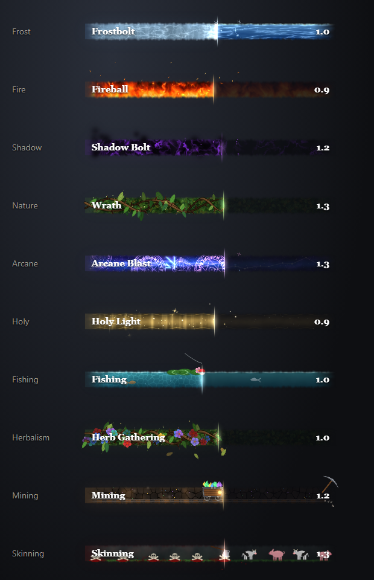
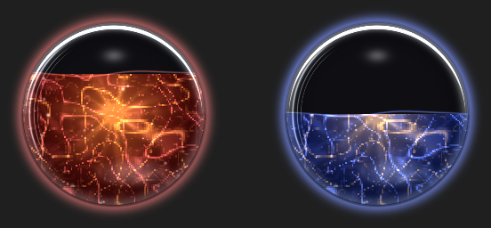

# Dave's WoW Addons

World of Warcraft addons for **WoW: Forever** (Interface `16001`), plus the toolkit (`wow-addon-kit`) used to scaffold, validate, review, debug, and link them.

## Contents

| Folder | What it is |
| --- | --- |
| [`wowaddons/daves_balls`](wowaddons/daves_balls) | **Dave's Balls**: Diablo-style health and power orbs with sloshing liquid, cursor glare, optional animated bottom holders, orb bobbing, light-driven cast shadows, and 3D swirling dust motes with selectable orbit patterns (`Auto`, `Halo Ring`, `Twin Helix`, `Figure-8`, `Vortex`, `Atom Shells`, `Chaos`), rotation, spread, true sphere-rim occlusion, curved comet tails, and independent shimmering dust trails (`v0.2.5`) |
| [`wowaddons/daves_castbar`](wowaddons/daves_castbar) | **Dave's Cast Bar**: animated player cast bar with 21 looks — 7 elements, 4 gathering & 7 crafting professions, Disenchant, First Aid, and Plain (`v0.6.1`) |
| [`wowaddons/daves_chat`](wowaddons/daves_chat) | **Dave's Chat**: movable wide-screen chat dock (`Chat`, `Combat Log`, `General`) with an auto-closing collapsible left tab list, bordered inner chat pane, `Text direction`, and frosted-glass `Faint` mode (`v0.3.11`) |
| [`wowaddons/daves_map`](wowaddons/daves_map) | **Dave's Map**: windowed, opaque tracked/focused-objectives-only default world map layer with optional zoom-faded POI layers and tab-driven `Zone` & `Dungeon` marker layers, movable & resizable (`min width 588px`) HUD Edit Mode styled slim icon-rail **`Base` / `Tracker` / `Zone` / `Dungeon`** sidebar that opens/closes with the map and docks flush beside it (native right-side `MinimalScrollBar`, 3-sliced brass pill buttons, skill-style brass icon tabs & gold toolbar icons, **Window Style** dialog, strict per-character completion with `/dmap check`, sortable 4-column `Quest \| Starter \| Lvl \| XP` grids with starter-grouped chains & item-only reward tooltips, and origin-frozen search), Ready-to-Turn-In & zone quest tracker, and OpenMap seamless world & dungeon maps (`v0.8.40`; companion addons `daves_map_data` & `daves_map_textures`) |
| [`wowaddons/daves_map_data`](wowaddons/daves_map_data) | **Dave's Map (data)**: QuestieDB Forever pins, objectives, turn-ins, quest item rewards, dungeons, and quest chains for `daves_map` (`Update-MapData.py`) |
| [`wowaddons/daves_map_textures`](wowaddons/daves_map_textures) | **Dave's Map (textures)**: OpenMap `v0.8.10` seamless world & dungeon map art and data tables for `daves_map` (`Update-MapTextures.py`) |
| [`wowaddons/daves_outofmyway`](wowaddons/daves_outofmyway) | **Dave's Out Of My Way**: Edit Mode Need/Greed loot-roll mover and never-collapsed buff frame (`v0.1.5`) |
| [`wowaddons/daves_sack`](wowaddons/daves_sack) | **Dave's Sack**: all-in-one HUD Edit Mode bag replacement with collapsible categories or an optional "One big bag" slot grid, reagent-bag & ammo-bag routing + post-Sort sweep, matching gold toolbar icons (sort, settings gear, trash/delete, and auction gavel), local Auction House price cache & companion **Market Analysis & Insights** window (global search bar + **Margin**, **Scarce**, **Professions**, **Bag Advisor**, and **Bait & Snipe** with **Counter-Snipe Top 50** radar), and taint-safe secure controls (`v1.7.46`) |
| [`wowaddons/daves_frames/tools`](wowaddons/daves_frames/tools) | Standalone `16:9` UV stencil & layered AI target-frame painting/packing toolkit (`Build-FrameTemplate.py`, `Pack-FrameTemplate.py`, `template/PAINT-LAYERS.md`) |
| [`wow-addon-kit`](wow-addon-kit) | Plugin (`wow-forever-addons`) and Python CLI toolkit for scaffolding, static API/secret/taint validation, review packets, in-game error/taint inspection, and linking |

## The addons

### Dave's Cast Bar (`daves_castbar`)

An animated cast bar that replaces Blizzard's. Each spell gets one of 21 looks, and every cast is different: seven elements (`frost`, `fire`, `shadow`, `nature`, `lightning`, `arcane`, `holy`), four gathering professions (`fishing`, `herbalism`, `mining`, `skinning`), seven crafting professions (`smelting`, `blacksmithing`, `alchemy`, `tailoring`, `leatherworking`, `engineering`, `enchanting`), `disenchant`, `firstaid`, and Blizzard's `plain` bar — picked automatically from the spell or its recipe. Framed or borderless, square, soft or rounded corners, flat or bevelled.



```text
/castbar                 options
/castbar test fishing    play a pretend cast of one look (frost, fire, shadow, nature, lightning, arcane, holy, fishing, herbalism, mining, skinning, smelting, blacksmithing, alchemy, tailoring, leatherworking, engineering, enchanting, disenchant, firstaid, plain)
/castbar set frost       right after casting a spell: always give that spell this look (/castbar set auto undoes it)
/castbar unlock          move and resize the bar outside Edit Mode (/castbar lock, /castbar reset)
```

In Edit Mode, drag the bar to move it (snaps like Blizzard's frames), drag its corner to resize it, and click it for settings. More in [its README](wowaddons/daves_castbar/README.md).

### Dave's Balls (`daves_balls`)

Diablo-style health and power orbs, with swirling liquid that sloshes while you move and glass that catches the light from your cursor.



```text
/balls                   options (/davesballs alias)
/balls holder <variant>  set bottom holder for both orbs (none, chalice, arcane, sanctum)
/balls unlock            drag the orbs anywhere; left- or right-click one for settings (/balls lock when done)
/balls reset             put both orbs back
```

In Edit Mode, left- or right-click an orb for its own settings: liquid and accent colours, compact **Orb text** (`Off`, `Numbers`, `Percent`, `Both`), the accent pattern, optional per-orb bottom holder (**Gilded Chalice**, **Arcane Cradle**, or **Sanctum Lotus**), **Bob intensity** (`Off` / `5%`–`100%`), **Cast shadow** (driven by the cursor light hitting the orb), and 3D **Swirling dust** with true sphere-rim occlusion (**Orbit pattern**: `Auto`, `Halo Ring`, `Twin Helix`, `Figure-8`, `Vortex`, `Atom Shells`, `Chaos`; **Particle count** `Off` / `2`–`40`, **Dust speed**, **Pattern rotation** `-180` to `+180 deg`, **Particle spread** `0%`–`100%`, **Trail style** `Off` / `Tails` / `Dust` / `Both` for independent curved comet tails and shimmering **Dust trails**, and **Tail length**). The orbs can also hide Blizzard's player frame and work like it: left-click targets you, right-click opens your menu. More in [its README](wowaddons/daves_balls/README.md).

### Dave's Chat (`daves_chat`)

Movable, resizable wide-screen chat dock (`Chat`, `Combat Log`, `General`) with a header eye button to show or hide an auto-fitted scrollable left-side tab list (which also closes automatically back to full-width chat when your mouse leaves the window), a bordered inner chat frame with a pixel-aligned input box, selectable `Text direction` (`Bottom` stock default or `Top` newest-first), `Faint` mode (chrome fades down to a translucent frosted-glass backing on the chat section only, with `Faint glass` strength slider, `Faint glass color` picker, and auto-fade to `0` when old messages fade out until a new message arrives), Default Window tab selection, and collapse-to-bubble icon.

```text
/daveschat               open Window Settings
/daveschat chat          open Blizzard's Chat Settings
/daveschat tabs          reapply the default Chat / Combat Log / General tab layout
/daveschat reset         reset window position
```

More in [its README](wowaddons/daves_chat/README.md) and [NOTES.md](wowaddons/daves_chat/NOTES.md).

### Dave's Map (`daves_map`)

Shows only your tracked/focused quest objectives and ready turn-ins on the World Map by default (via companion addon `daves_map_data`), paired with a movable, resizable (`min width 588px`) slim skill-icon left-rail **`Base` / `Tracker` / `Zone` / `Dungeon`** sidebar that opens and closes with the map (optional zoom-faded POI toggles & Map Settings in `Base`; `Focused`, `Ready to Turn In`, `Pinned`, and `Tracking` quests on the Base map layer in `Tracker`; zone quests & inline starter-grouped chains with `+`/`-` brass pill buttons, clickable Starter links, numbered bullet steps, and item rewards in `Zone`; zone dungeons, floor maps & dungeon quest starters in `Dungeon`; sidebar-link precedence so out-of-zone links never swap your view; and strict per-character quest completion), Ready-to-Turn-In & zone quest tracker, and OpenMap `v0.8.10`'s seamless stitched world map and multi-floor dungeon/raid maps (`Stitch/` + companion addon `daves_map_textures`).

```text
/dmap                    toggle the map pin layer (/davesmap alias)
/dmap dock               re-dock beside the World Map at default 588px width (/dmap reset)
/dmap style              open the Window Style dialog (same sliders & background styles as Dave's Sack)
/dmap options            open Base & Map Settings
/dmap check [questID]    verify strict per-character quest completion flags
/dmap zone               inspect zone quest tracking state (/dmap seamless, /dmap calib)
```

More in [its README](wowaddons/daves_map/README.md).

### Dave's Out Of My Way (`daves_outofmyway`)

Moves Blizzard's Need/Greed loot-roll frames in Edit Mode via a taint-free `GroupLootContainer_Update` post-hook, and keeps Forever's buff frame permanently expanded by toggling `consolidateBuffs` and `collapseExpandBuffs` cleanly at `PLAYER_LOGOUT`.

```text
/oomw                    options (/davesoutofmyway alias)
/oomw reset              return loot rolls to Blizzard's default spot
/oomw buffs              inspect buff-frame CVar state
```

More in [its README](wowaddons/daves_outofmyway/README.md).

### Dave's Sack (`daves_sack`)

One bag window for all your bags, styled like Blizzard's HUD Edit Mode window. Items are sorted into collapsible categories (including Ammo, Forever Camping & Keys, Equipment split into **Item Sets** — with one-click `[Locked]` / `[Unlocked]` protection and drag-and-drop custom set gear — and Other Equipment, Consumables split into Alchemy / Food & Drink / First Aid, and Reagents split by profession) or shown in one continuous **"One big bag"** slot grid, with search, sort, quality-coloured slots, reagent-bag & ammo-bag (quiver / ammo pouch) Free Space, footer capacity & priority routing, an item destroy/trash button to the left of the search bar (with `"Confirm delete (trash)"`), local Auction House price & market caching (unit & stack prices on item tooltips, tradeable bag AH value and cache age in the footer, and a gavel button beside Settings that opens a companion **Market Analysis & Insights** window with **Margin**, **Scarce**, **Professions** — showing per-profession **Cost to Make vs. Sell** and **Top Trades** — and **Bag Advisor** tabs), backpack currencies, and corner resizing.

```text
/sack                    open or close the bags (/davessack alias)
/sack market             open the companion Market Analysis & Insights window (also the gavel button)
/sack bait               open Market Analysis on Bait & Snipe (/sack bait test previews alert; /sack counter toggles Top 50 radar)
/sack scan               force an Auction House deep scan while the AH window is open
/sack lock | unlock      lock or unlock all items in the Equipment -> Item Sets sub-category
/sack options            settings (also the gear button in the window, plus Esc > Options > AddOns > Dave's Sack)
```

More in [its notes](wowaddons/daves_sack/NOTES.md).

The cast bar and orb pictures are rendered from the addons' own art (`tools/Show-Preview.ps1`, `tools/Preview-Orb.py`), not taken in the game.

## After cloning (or pulling)

Link every addon in `wowaddons/` into the game, so it loads straight from the repo. Run from the repo root; re-run after a pull that adds an addon (existing links are left alone).

Windows (`py -3`, no admin needed; makes junctions):

```powershell
py -3 .\wow-addon-kit\plugins\wow-forever-addons\scripts\Link-WowAddons.py
```

Mac (makes symlinks; looks for the game in `/Applications/World of Warcraft`, override with `-Root` or `--wow-root`):

```sh
python3 wow-addon-kit/plugins/wow-forever-addons/scripts/Link-WowAddons.py
# or pure-bash fallback:
bash wow-addon-kit/plugins/wow-forever-addons/scripts/link-wow-addons.sh
```

Add `-WhatIf` (`--dry-run` for bash) to preview, and `-Remove` (`--remove`) to unlink. An existing real folder with the same name is moved to `Interface/AddOns.backup/` first. Then fully restart the game once and enable the addons.

## Installing an addon without the repo

Ready-to-extract `<addon>.zip` packages for all 8 tracked addons (including `daves_map_data.zip` and `daves_map_textures.zip`) live on the [`releases` branch](https://github.com/DavidWhit/daves-wow-addons/tree/releases) (updated automatically via `Publish-WowReleases.py -Push`). Download any `<addon>.zip` and extract it into your game's `AddOns` folder, or copy an addon folder from `wowaddons/` into:

```
<WoW install>\_forever_\Interface\AddOns\daves_sack
```

## Using the addon kit

```powershell
claude plugin marketplace add ".\wow-addon-kit"
claude plugin install wow-forever-addons@wow-addon-kit
```

See [`wow-addon-kit/README.md`](wow-addon-kit/README.md) for the full list of skills and scripts.
